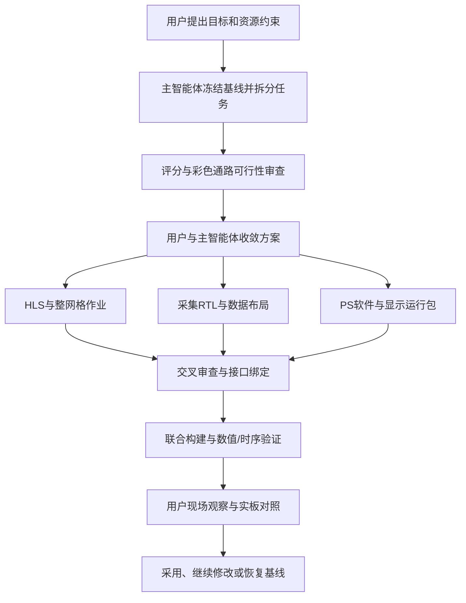

# 大模型交互记录

## 目录

1. 项目需求与工程接手
2. 可控场景与识别原型
3. 摄像头采集与 HDMI 显示
4. 静态验证与板端闭环
5. 实时多码与专项协调
6. 现场诊断与统计口径
7. 前置规则反例验证
8. Linux 环境与工程迁移
9. 成像对照与瓶颈定位
10. 协同加速与对照验收
11. 技术文稿与展示材料
12. 技能提炼与独立试用

# 1 项目需求与工程接手

## 2. 实现方案：用真实目录与最新版本纠正错误上下文

提示词与追问

> 我刚刚说的不够清楚，G:\\*\ZYNQ7020
> 我需要你阅读这个文件夹，这里有当前进度的信息，你在阅读完后，按照我刚刚给的要求，给我提几个实现方案

> 库里更新了新文件，以最新版为准，重新分析

模型回答与纠错轨迹

模型起初仅查看当前 `hello_world` 工作目录，将项目误当作接近空白的工程，给出从摄像头和 VDMA 起步的通用方案。我明确路径并要求以新提交为准后，模型重新阅读源码和 README，发现已有视频链路及包含 quirc 的 V1 参考，改写为 PC 保底、裸机 PS 主线、进一步 PL 加速和有条件的 Linux 路线。

写作过程与产出

同一个“实现方案”请求，经路径和版本约束后，从泛化建议变成基于已有资产的阶段规划。之后我要求总体方案只保留各部分关键信息，模型又将保留全文的重排稿改为短纲要。这里的主要纠正由人工发起：先纠正资料范围，再纠正文稿粒度。

工作流

确认目录与提交 → 阅读已有实现 → 区分已完成和待实现 → 比较路线 → 输出阶段方案或纲要。候选方案不等于当时已全部上板完成。

## Q02 工程接手、工具安装和板卡启动

提示词

> 这个工作文件夹是我们正在做的一个项目，由于之前都是另一个人在做，我不太了解，我现在需要你阅读文件夹里所有的.md文件，告诉我现在已经完成了什么，并指导我接下来应该如何操作，应该完成什么内容，其中“虚拟传送带场景网页”这个文件夹不需要看

> 我现在已经得到3 passed了，接下来怎么做

> 已经重新插好并上电

交互过程

- 原会话题目：这个工作文件夹是我们正在做的一个项目，由于之前都是另一个人在做，我不太了解，我现在需要你阅读文件夹里所有的.md文件，…
- 需求：先读工程文档，解释进度，逐步指导环境和板卡操作。
- 反馈与迭代：用户提供 JTAG、串口与初始化日志，反馈重连上电；不能把空串口直接归为电脑环境问题。
- 结果与边界：最后一次回答把阻塞缩小到摄像头 ID 初始化阶段；这段结束时没有证明视频出流成功。

## Q03 环境复核与以太网结论修正

提示词

> 现在的这个文件夹是我们正在做的一个嵌入式项目，我现在需要你阅读一遍这个文件夹里的所有markdown文档，告诉我这个项目已经完成了哪些部分，接下来需要做什么，然后需要你帮我看一下我的电脑上，是否把所有需要用到的软件都安装好了

> 现在我需要你详细指导我如何进行后续的步骤，我先不连板子，只把这台电脑上需要弄的环境配好

> 现在我先暂时不安装这些应用，我们的项目又有了更新，我需要你再重新看一遍，告诉我现在完成了什么接下来要完成什么，然后，我需要你以`E:\*\ZYNQ7020\ov5640_Ethernet`为例，告诉我一下开发这块板的一个流程，并解释每一步是在干什么，需要详细解释，因为我现在什么都不会

交互过程

- 原会话题目：现在的这个文件夹是我们正在做的一个嵌入式项目，我现在需要你阅读一遍这个文件夹里的所有markdown文档，告诉我这个项…
- 需求：再次梳理项目与软件环境，以完整视频工程解释开发流程。
- 反馈与迭代：独立 Ethernet_Test 的成功证据推翻此前偏向 PHY 硬件故障的判断。
- 结果与边界：助手指出 JL2121、速率判断、IP 配置与 ARP 修复，并明确完整视频工程仍需同步补丁。

# 2 可控场景与识别原型

## Q01 虚拟传送带需求与随机供给

提示词

> 我现在正在做一个基于ZYNQ7020的项目，这个文件夹的.md文件里有简单的介绍。我们使用的开发板和摄像头如附件材料所示。由于我们的项目涉及到“智能仓储和自动化物流中的高速信息采集”，而我们没有这个实际的场景。所以，我现在想做一个虚拟的场景。我初步的想法是，做一个网页，在这个网页中，可以模拟智能仓储场景中，很多的二维码在传送带上快速经过的场景，让我们能够通过…

> 现在存在的问题：（1）当包裹密度过大的时候，很多二维码会重叠在一起，但实际场景中，一般不会出现这个现象，我希望你改成每个包裹都独立，相互不要重叠（2）包裹移动的速度不一致，有的包裹移动速度过快，有的包裹移动速度慢，导致原本不重合度包裹会出现重合，实际场景中传送带速度恒定时，包裹速度应该一致（3）包裹集中在了模拟传送带的上半部分，我希望下半部分也有包裹（4）包…

> 我不希望按照上中下三个部分依次生成，因为实际场景是不可预测的，能不能在三个通道上随机生成？

交互过程

- 原会话题目：我现在正在做一个基于ZYNQ7020的项目，这个文件夹的.md文件里有简单的介绍。我们使用的开发板和摄像头如附件材料所…
- 需求：缺少真实仓储场景，希望用网页模拟运动二维码；先评估再制作。
- 反馈与迭代：反复纠正批次供给和轮流车道，要求连续生成、密度可控、车道随机且不重叠。
- 结果与边界：助手汇报完成随机车道调度和语法检查；并非真实输送设备验收。

## Q09 验证网页增强与绘制性能

提示词

> 我需要你先读一遍”ZYNQ二维码识别总体方案.md“,明确我们现在正在做什么。在”`E:\*\ZYNQ7020\`虚拟传送带场景网页“这个地址下，是我们为了验证二维码识别专门设计的一个网页。但是这个网页现在比较粗糙，我想要再完善一下。（1）首先，在”`E:\*\ZYNQ7020\qr_validati`…

> 我需要你再加一个功能，就是录制视频的功能，但是只录制传送带实时画面的视频。开始仿真并开启这个按钮后，开始录制，然后可以手动暂停或结束录制，结束录制后可以选择保存视频或不报存，不保存的话就不占用任何内容，先明确我的要求

> 帮我修改

交互过程

- 原会话题目：完善二维码验证网页需求
- 需求：统一场景风格，避免包裹重叠，增加旋转和圆柱形变等控制。
- 反馈与迭代：后续反馈绘制卡顿，要求改善网页性能及录制行为。
- 结果与边界：助手汇报预生成缓存和减少 DOM 更新，给出该环境的帧率回归；不代表后期所有网页版本无卡顿。

## 7. 真值、跨帧跟踪与测试生成器：把“识别效果如何”写成可执行规格

提示词

> 请你抓串口30s，告诉我识别效果如何
>
> 根据这两条修改，同时尝试实现在HDMI输出的视频标注右上角识别信息（队列，单个二维码信息至少显示3s）

模型回答与实施：模型先报告30秒新增17个不同payload、71次解码实例，并用编号跨度得到约51.5%的覆盖估算；同时明确不能作为严格识别率。后续共同形成网页ROI真值、时间戳串口CSV、跨帧目标跟踪和HDMI FIFO实施计划，由用户确认实施。

纠错与规格收敛：分母改为实际完整进入ROI且可见区间落在抓取窗口内的目标；跟踪避免已识别物体重复解码，队列负责结果可见驻留。模型最终明确桌面仿真/构建完成，板上A/B仍待测，未把实现计划当作召回率已经提升。

与此配套，另一段完整聊天从“输出传送带视频”逐步扩展为随机模块尺寸、模糊/污损、速度、种子与JSON配置生成器，用户明确“不再需要网页端识别”。模型移除模拟识别标记，区分实际图像解码与网页模拟状态。该聊天还出现直接的文档错误：模型修改了根README，`*` 指出“我要修改的是项目对应的README.md”；模型恢复根文件并做字节核对，改写项目README。

结果与代表性：测试平台、统计口径、跟踪和输出展示在多轮对话中共同成形；用户不仅补功能，也纠正模型改错文件的范围。已知裁剪区域解码、常规定位解码、板端识别及网页模拟不是同一证据。

可见工作流：观察日志 → 发现统计缺口 → 明确数据与时间字段 → 用户确认计划 → 开发生成器与分析器 → 分层验证 → 修正文档目标。

## Q04 PC 视频接收与第一版二维码识别

提示词

> 现在的这个文件夹是我们正在做的一个嵌入式项目，我现在需要你阅读一遍这个文件夹里的所有markdown文档，以及相关的关键的文件，告诉我这个项目已经完成了哪些部分，接下来需要做什么。然后，由于之前一直是我的队友在弄，我从来没有使用这块板子，我需要你一步一步详细地教我如何在我的电脑上实现摄像头画面传输、通信（功能包括但不限于这两个）等等之前他已经打通的功能

> （1）算法迁移到 PS 后再启用真实 UART 输出 ，先按照你推荐的方式输出（2）第一版算法按照你推荐的来，需要你帮我完成编写，并告诉我后续如何操作（3）你写的东西都放在`E:\*\ZYNQ7020\PC_QRcode_Recognition`这个文件夹里，不要改动其他文件夹，如果其他文件夹有需要复用的，就复制到这里面来（4）相…

> 现在摄像头识别有一个问题：对于一些简单的二维码（看上去黑白色块都没有很多很复杂），识别成功率是比较高的，基本上能圈出绿框。但是，对于复杂一些的二维码，基本上都是识别出黄框，只是偶尔会跳出一下绿框，但是成功率特别低，基本上不会有。我现在需要你先给我详细讲解一下目前使用的识别算法，然后再帮我排查一下这个问题。这一轮对话不要做出任何修改

交互过程

- 原会话题目：梳理项目进度并指导上手
- 需求：复现队友已有功能，再实现运动多码检测与解码；保留后续板端迁移方向。
- 反馈与迭代：用户确认录像成功，限定修改目录，要求先评估再写代码；后续反馈无框、对焦困难和密集码多黄框。
- 结果与边界：形成 PC 原型、运行手册和诊断讨论；复杂码根因仍需更多证据，不能只依赖首次解释。

## Q05 复杂码排查与静态板端路线

提示词

> 我们现在正在做二维码识别算法，我需要你先看一遍`E:\*\ZYNQ7020\PC_QRcode_Recognition`这个地址下的.md文档，了解目前的进度。以及我们的最后一次排查如附件。我们尝试过把二维码放大，但是仍然存在：大多数情况下都是黄框，只有用它来识别比较简单的二维码时，成功率才比较高。我需要你帮我排查这个问题，给出修…

> 给我解释一下现在我们摄像头识别二维码的算法是怎么样实现的

> 需要你把这个思路写成一个markdown文档

交互过程

- 原会话题目：排查复杂二维码解码失败
- 需求：放大二维码仍失败，希望明确修改方向，先不改。
- 反馈与迭代：比较稳定绿框样本与自制网页，质疑 PC 成功能否迁移到 Zynq，并指出屏幕反光等混杂因素。
- 结果与边界：从 PC 有界 ROI 回退讨论转向静态库、PL、PS 与通信的分阶段方案，最终写成方案文档。

# 3 摄像头采集与 HDMI 显示

## 3. 摄像头与 HDMI：用户画面反馈持续收窄“已经完成”的含义

提示词与反馈

> 外接显示屏没有任何输出……从main()运行完成后进入了_exit()等待，请修复这些问题

之后用户确认看到视频，却继续指出方向、顶部行错位、矩形残影、颜色和分辨率问题：

> 颜色不正确，红色与蓝色相反，请检查
> 画面依旧和显示屏相反，需要旋转180°
> 修复这些问题，不需要硬件测试，修改完告诉我即可

模型回答与实施：模型围绕相机寄存器、RGB565通道、AXI帧行边界、VDMA和持续运行逻辑修改，增加分辨率/FPS硬件OSD，后来升级到800×600。完整记录还显示：用户已要求继续做到可看视频，模型一度仍沿用旧的“生成XSA即可停下”条件汇报，说明长任务中旧停止条件也可能被错误继承。

纠错轨迹：用户确认有视频，只证明当时主链路工作；随后仍发现颜色和方向错误。记录还发现 Debug 目录旧 bit 与已验证 bit 哈希不同，促使核对实际下载的成套产物。后续防撕裂方案从选择变化最大的缓冲、推导完成帧索引，发展为独立快照；后来的实时采集实验中，直接读虽然略快却有CRC错误，未被当作有效优化。

结果与代表性：模型逐渐把“仿真、DRC、时序、XSA内容、ELF构建、真实显示”分别表述；用户改为不做硬件测试后，新版只报告离线验证，不继承旧版本板测。快照也不能无条件保证安全，复制期间源帧仍须稳定；本次回顾区分了当时解释与后续推翻它的证据。

可见工作流：现场观察 → 分层诊断 → 核对产物身份 → 修改与验证 → 再观察 → 根据最新授权明确待测范围。

# 4 静态验证与板端闭环

## Q06 静态验证库与 PS 平台规划

提示词

> 这个文件夹是我们现在正在做的一个项目。你可以先阅读一下相关的.md文档，了解我们正在做什么。然后我们接下来要做的事情是在ZYNQ静态二维码识别第一版方案.md这个文档里写的，你需要重点看。目前我只需要你构建出一个静态二维码验证库，静态二维码验证库放在`E:\*\ZYNQ7020`这个地址下，新建一个文件夹。这一轮对话只读和明确…

> 我现在需要你给我详细梳理一下，我们第一版的处理二维码的过程

> 帮我把最终的正式路线补充到之前的.md文档里

交互过程

- 原会话题目：梳理静态二维码验证库需求
- 需求：构建静态二维码验证库，先明确需求，并完善第一版路径。
- 反馈与迭代：持续讨论验证边界、PL/PS 演进以及裸机、Linux 的取舍。
- 结果与边界：最终回答追加 PS 正式路线：裸机作基线，Linux 经门槛后迁移；这些属于当时规划，不等于当时已迁移。

## 5. 静态 QR 的 PL 第一版：纠正“生成 XSA/bit 就算完成”的验收口径

提示词

> PL端负责图像预处理，包括：RGB转黑白、二值化、定位
> 实现PS-PL的通信
> 当前只需要实现PL端

用户提供方案文档，指定 `vivado-vitis-flow`、Vivado MCP及独立 `qr_on_board` 目录，后续又问：“我看到生成了xsa，是否已经可以”。

模型回答与实施：模型展开DDR→VDMA→预处理→VDMA→DDR硬件闭环，建立候选RAM、AXI-Lite读取、RTL仿真及构建脚本，首阶段明确不实现PS解码。

纠错轨迹：先出现外部 `irq_0` 约束DRC问题；检查已存在的XSA，又发现没有bitstream。用户生成bit后，模型继续查到DRC已过，但WNS为−11.432ns、TNS为−42897.875ns，不能达到稳定运行门槛；旧XSA还需与新bit配套导出。这不是一次“模型先错后改”的完整反转，而是用户逐项询问推动验收标准变得明确。

结果与代表性：“文件存在、bitgen成功、时序通过、真实运行”成为独立结论；PL通路完成也不等于整机二维码解码完成。提示词中的阶段边界在回答与交付中得到保留。

可见工作流：限定阶段 → 形成实施计划 → 生成工程 → 核查真实产物 → 独立检查时序与导出 → 明示未完成项。

## Q07 首版静态上板、批量验证和封存

提示词

> 这个文件夹里是我们正在做的一个项目，里面有很多的.md文档，我需要你先读一遍，了解我们这个项目到底是在做什么。然后，我需要你重点看ZYNQ二维码识别总体方案.md文档，结合实际情况，帮我评估我们这个方案的合理性，有没有什么需要调整的地方

> 我需要你给我写一个完整的执行步骤的.md文档，方便我验证

> 帮我把没有必要留下的东西清理掉吧，然后在“ZYNQ二维码识别总体方案.md”里写一个交接文档，告诉交接的下一个人，现在已经完成了什么，结果是什么，接下来应该读哪些文档了解工程，接下来应该做什么

交互过程

- 原会话题目：评估 ZYNQ 二维码识别方案
- 需求：接续队友未完成工程，按总体方案完成第一版并提供完整操作步骤。
- 反馈与迭代：用户提供运行和串口结果，要求分清显示间隔与板内耗时，进一步测试 110 张输入并保留关键产物。
- 结果与边界：助手汇报封存 V1、配套固件与 110 张结果，更新交接文档；本轮未重做该测试。

## 6. UDP 回放验收与交接文档：从“继续修改”变为明确的 P0/P1

提示词

> 人为制造单包/多包丢失，确认半帧不会进入 READY
> 验证残帧回收、CRC 失败和 packet-loss 统计
> 进行长时间 30 fps 稳定性测试

QR阶段又要求结果与输入frame ID逐帧对应，测量耗时，并验证过载时丢旧帧但不产生旧结果错配。

模型回答与实施：模型加入逐包pacing、帧预编码、调度调整、槽位保护及故障注入，产生JSON、CSV和Markdown验收报告。最初物理链路正常，仍因每帧700包瞬时突发而出现残帧，促使检查从“连通性”推进到传输准入与服务时机。

纠错轨迹：传输长稳为53,999/53,999帧、29.999fps；严格QR在5fps下为110/110预期结果匹配，其中包含负样本。QR的30fps测试只返回71个正确结果，另39帧按策略舍弃。模型某次极简回答写“110个测试帧全部识别正确”，本次应修正为“预期结果全部匹配”，也不能把传输30fps写成全输入QR识别30fps。原回答另明确本次主要改善传输，处理速度基本没变。

交互写作修订：`*` 要求重写交接文档：“提纲挈领地写明今天做了什么”，并指出问题处理与使用方式属于README。模型据此改变文档职责，按成果和下一步组织交接。

可见工作流：发现残帧 → 共同写验收计划 → 故障注入 → 长稳与识别分别测试 → 准确解释分母 → 用户编辑文档结构。

# 5 实时多码与专项协调

## 4. 智能体协作：主聊天统筹三个专项，公共接口交叉审阅

提示词

> 我需要你作为主智能体，统领FPGA大赛这个项目下的二维码追踪、小二维码、斜二维码这三个子任务聊天……请你们四个智能体协同协作，允许你向这些聊天发送任务和追问，并在本聊天跟踪进度、汇总结果。每个任务要先给出多种解决方案……先不要做代码修改

模型回答与实际工作流

主聊天向三个现有聊天发送任务、汇总多方案；公共入口、fallback 和共享接口由主聊天统一处理。追踪专项关注身份和发布，小码专项关注尺寸与阈值，斜码专项关注几何及裁剪；新增救援扫描共用预算，避免各专项独立叠加开销。

我随后调整顺序，要求先只取消 2×2 降采样，其他聊天静态审阅。交叉检查发现 BIT、ELF 已分模式，但 BSP 工作区仍共用，推动 BSP 也隔离。后续实现又由 `pl_stream`、`pl_geometry`、`ps_binary` 三个代码代理分工，交换流水延迟、FIFO 和 AXIS 稳定性问题。

纠错轨迹与产出

一版代码语法检查通过，综合却出现约 12.9 万寄存器、超出器件容量。模型没有把语法通过当成交付完成，而是分模块检查 RAM 推断与算术时序；其中 FIFO 从约 3.7 万 FF 改为 57 FF＋1.5 BRAM。并行工作的价值体现在接口互审和修复，而非仅增加代理数量。

## Q11 PL ROI 集成、输出诊断与展示

提示词

> 我现在需要你先看一下`E:\*\ZYNQ7020\qr_video_replay`这个地址下的交接文档HANDOFF_20261011_CURRENT_STATE.md（重点看这个），以及其他相关的文件，明确我们的项目在做什么，接下来应该做什么

> 重新测试，不要刚刚的结果，这次每组测100个

> 我需要你给我详细讲解一下我们的整个工程，PL端和PS端是怎么实现的，要很详细的讲解

交互过程

- 原会话题目：梳理项目现状与后续计划
- 需求：梳理最新架构，执行测试，解释解码与发布差异。
- 反馈与迭代：用户要求作废无效轮次、每组 100 码、补返回值诊断，再做 200 码倾斜展示并形成老师版说明。
- 结果与边界：最后详细说明 candidate02 的 PL ROI、Gray8、ROI Otsu 与 quirc；主会话内保留了现场条件变化和统计限制。

## Q15 最新状态理解与多码原理讲解

提示词

> 我现在需要你看一下这个文件夹，告诉我我们这个项目最新的进展是什么

> （1）现在是否在HDMI显示时，有圈出ROI的篮框和PS解码成功的绿框（2）现在PS和PL处理图像的帧率是多少

> 给我讲解一下PS识别二维码的原理，是否能在处理一张图像的时候，同时识别出多个二维码

交互过程

- 原会话题目：查看项目最新进展
- 需求：读取最新工程，解释各部分实现和当前显示、帧率。
- 反馈与迭代：用户进一步询问同一帧能否同时识别多个二维码。
- 结果与边界：助手说明当时 PS 顺序处理多 ROI、多 grid，每帧最多保存 8 个实例并受软预算限制；属于当时架构讲解。

# 6 现场诊断与统计口径

## 3. 现场诊断：空画面不能证明运动码被采样漏掉

提示词与模型初答

早期实时识别调试中，模型抓到一张没有二维码的画面后，给出“结论非常明确”“这正是传送带场景下的结构性漏检”等判断。我随即纠正：

> 你采集这帧的时候我已经停止摆放了，现在摆放好了，你再试一下

模型回答与纠错轨迹

模型撤回过强归因：

> 明白，上一张只能说明抓帧时二维码已经移开，不能代表刚才运动过程中的输入。

随后重新测试，静止画面解出了 `BOX-01147`、`BOX-01148`。这只能证明该静态输入可解，不能证明运动漏检已经解决。后续斜码调试中，我再次指出相机摆放有问题，模型将未确认取景的旧实验降为探索记录；重新确认后的实际 ROI 首扫解出 K6 的 45° 码，进一步约束了“旋转必然失败”的泛化。

写作过程与工作流

我补充模型无法自行知道的现场条件，模型据此修订诊断文字和证据等级。流程变为：先确认目标、取景和时刻，再核对真正消费的图像，最后定位算法阶段；保留旧判断及其被推翻的原因。

## 7. 实验分析：承认诊断固件已改变，区分计分完整与归因完整

提示词

> 先前较好的测试跟当前这次在代码上有什么区别，你上次和这次对话又是在做什么修改?

模型回答与纠错轨迹

一次诊断轮只有 23/100，并出现约 65.8 秒停顿。模型此前以“算法判断未改”描述操作，我追问后，它明确承认：

> 我确实临时修改了PS代码，并烧录诊断版跑了23/100那轮。此前“算法判断未改”的说法，不能理解为“固件完全没改”。

诊断增加约 1.74 MiB 数据及轨迹快照工作，不能当作无影响观测；该轮也不能直接与此前 88/100 作公平比较。同时，恢复原固件后仍出现 72/100、47/100，说明原系统存在波动，不能反过来断言所有退化均由诊断引起。

后续统计与文档写作

300、1000 目标试验采用保存的真值、随机间隔和分项统计，记录 272/300、921/1000。模型明确区分：1000 轮全程计分完整，但详细诊断仅覆盖前约 588 秒，不能对所有漏码及最后一次重复输出定因。交接与分析材料因而保留失败轮、无效轮、诊断覆盖和固件身份，而非只写成功成绩。

工作流：固定输入与固件 → 执行和计分 → 核验记录覆盖 → 分级归因 → 写入报告与交接。最终总结中的 4997/5000 属于后期独立实验，不倒填为本阶段成绩。

# 7 前置规则反例验证

## Q14 PS 构网前置校验的离线反例验证

提示词

> 请接手 `E:\*\ZYNQ7020` 项目。 先阅读根目录“交接文档.md”最前面的“2026-10-16当前交接入口”，按其中链接核对最新报告、源码和证据。后面的历史记录不能当作当前状态。 关键情况： 1. 正式主线是 qr_mainline_20261015，10.13原版冻结包必须保留，不得覆盖。 2. 最新实验源码是 q…

> 继续离线分析，优先检查实际调用过的长尾ROI，解释当前预警为什么没覆盖它们，并定位01054两个成功框timing低分的原因。暂不硬拒绝、不改PL、不上板，给出下一步可验证的改进方案。

> 先不分析了，我需要你把分析的一些中间过程产生的文件都清理掉，只保留最关键的

交互过程

- 原会话题目：评估下一步修改方案
- 需求：从干净 rev9 派生，只做诊断与回放，不硬拒绝、不改 PL、不上板。
- 反馈与迭代：继续检查实际长尾 ROI 和成功样本低分反例，用独立样本校准联合诊断。
- 结果与边界：最终按要求整理关键文件；离线诊断没有被宣称为已经部署且有效的过滤器。

# 8 Linux 环境与工程迁移

## Q10 Linux 迁移准备与虚拟机理解

提示词

> 我现在需要你帮我看一遍这个文件夹里的.md文档，了解我们的项目。目前我们的PS是裸机，后续我们想上linux系统。但是现在我们的PL和PS的分工框架还在变，我需要你告诉我后续上Linux应该怎么做、

> 帮我按照你说的，完成第二步，新建一个最小哦硬件XSA

> 现在我的队友已经弄好了一个linux虚拟机，位置在：F:\Ubuntu 64 位里，我需要你先看一遍，给我解释一下这个虚拟机是怎么弄的，我应该如何用

交互过程

- 原会话题目：我现在需要你帮我看一遍这个文件夹里的.md文档，了解我们的项目。目前我们的PS是裸机，后续我们想上linux系统。但是…
- 需求：裸机 PS 后续迁移 Linux，但软硬分工仍变化，需要评估时机和步骤。
- 反馈与迭代：用户围绕现有工程、Linux 环境和队友准备的 Ubuntu 虚拟机反复追问。
- 结果与边界：最后解释虚拟机配置、共享目录和网络；这是开发环境指导，不等于板端 Linux 已在该会话验收。

## 2. 裸机向 Linux-PYNQ 迁移：从能构建、能采首帧，推进到连续采集与版本对照

场景：把裸机二维码主线及后续 `false` 分支成果迁入 Linux，保留已有系统配置。

提示词

> 把这个项目同步到本地，但不要合并分支，继续在Linux-PYNQ中工作
> 可以使用PYNQ调试
> 考虑原裸机项目的HDMI视频输出如何和当前Linux配合，给我几个选项

后续要求：

> 在Github远程仓库分支false更新了裸机版本的最新版本代码，请把这部分改为Linux-PYNQ版本，保持现有的最新版的基本配置

模型回答与实施（摘要）

Codex 锁定上游提交，精简导入源码和必要发布材料，建立配套硬件、驱动与 Linux 运行时。HDMI 方案由用户选择；串口、SSH、网络、摄像头和桌面配置作为迁移约束保留。随后又按用户要求提供 B0、B1、B2-0、145、150 五套候选筛选版本，分别绑定启动包与运行文件，进行实板比较。

公开可见的纠错轨迹

1. JTAG 显示 CPU 运行、FPGA 配置完成，并不能证明 Linux 服务可用。黑屏与网络不可达仍继续单独检查。
2. 单帧采集通过后，模型发现连续采集只能取得首帧，未把“三次独立单帧成功”写成连续采集通过；后续修复后才记录 200 帧及 20 轮启停结果。
3. 用户要求“不需要30分钟测试，能够正常运行即可”后，模型停止扩大稳定性测试，交付时保留未测项。
4. 五版本对照中，145 在某些场景较均衡，150 在 K3 正向场景较好，但模型没有以门限更高就断言总体更优。
5. 固定八码诊断发现：评分 204 的 ROI 可解码，却被评分 226、不可解码的重叠候选替代；源码又证实原实现已有第四点估计和 padding，不能简单归因为“没扩边”。

工作流与结果

`锁定来源版本 → Linux 接口适配 → 成套构建 → 写卡 / 部署 → 首帧检查 → 连续采集 → 启停回归 → 多版本同条件对照 → 失败 ROI 回放`。

`b3a-145` 的 700 帧诊断进一步把问题拆为候选覆盖、代表选择、cluster 容量和 PS 重新定位成本。之后实现的 `b3a-145-union` 虽通过 64 帧采集 / 显示冒烟检查，但当时画面没有二维码，模型明确把实际合并效果留待正式测试。

代表性：提示词中的“保留配置、不要合并、提供多个版本”逐步转化为可比较、可恢复的迁移流程，验收也从构建层推进到真实运行层。

# 9 成像对照与瓶颈定位

## 3. 纸面与屏幕二维码测试：修正输入真值，并避免把输出次数当作识别率

场景：队友发现屏幕上的 K3 难识别，而纸面小码可以识别，需要区分成像、定位、调度和显示开销。

提示词与澄清

> 只测试k3和k6两个大小的码，分别测试，每一个码测试60s，在此期间，我会随即旋转二维码，以不同的角度扫描二维码
> 保持HDMI显示，直到60s测完一个大小的码，下次测试时再打开

用户先给出内容，之后纠正：

> 是 BOX-01001，之前少写了 1

另一轮则明确限定：

> 不需要判断是否正确，只需要判断解码成功个数

模型回答与实施（摘要）

Codex 恢复匹配版本，等待用户放码、对焦和开始指令；完成 K3 / K6 各 60 秒旋转测试，读取处理帧、解码事件、采集错误和分段耗时，并保留抽样图用于判断目标是否真正入镜。

公开可见的纠错轨迹

- 先以用户修正后的完整 payload 为真值核对，避免把少写字符的标签当作模型误读。
- K3 为 71/478 个处理帧含正确解码，K6 为 11/531。K6 抽样中存在未入镜、部分遮挡和拖影，因此模型明确：2.07% 不能代表清晰可见时的识别准确率，也不能证明 K6 更难。
- 分段计时把主要成本指向 HDMI 串行软件处理约 59–61 ms/帧，以及采集等待；纠错不是当时主要热点。
- 用户说“重新测试，我没有放二维码”后，上一轮被标记为无二维码场景，不用于评价识别效果。
- 后续混合屏幕测试得到 926 次成功输出、66 种不同内容，模型按用户范围只报告输出统计，注明重复读取与未核对正确性；没有包装成逐目标准确率。

工作流与结果

`确认实际 payload → 用户对焦 / 放码 → 明确开始窗口 → 板端分段计时 → 抽样检查入镜状态 → 分别统计事件、内容和目标覆盖 → 报告解释分母`。

进一步的五轮网页测试才使用清单真值，报告 725/1000 的目标覆盖；它与先前“926 次输出”具有不同统计单位，不能直接比较为同一个识别率。

代表性：人机对话不仅改变算法，还不断修正“测了什么、分子分母是什么、哪些现象支持何种结论”。

## Q17 C04 两个派生版与分段瓶颈测试

提示词

> 你将接手 AX7021B / Zynq7020 的 Linux 摄像头二维码识别项目。我是 Linux 新手，请结合项目现状解释和操作，不要假定我懂构建、驱动或部署。 接下来要在“原 C04”基础上开发。当前三个版本已归档： - 原 C04：`E:\*\ZYNQ7020\linux_bringup\20261021_001728`…

> 我现在重新上电了，可以直接在这张卡上写吗

> 接着刚刚的任务

交互过程

- 原会话题目：梳理 C04 基线并继续开发
- 需求：从原 C04 制作纯画面与 PL finder 两版，先离线再比较。
- 反馈与迭代：用户确认在现有系统备份后测试，作废调焦及意外轮次，最终统一速度 3.0。
- 结果与边界：三版 95/96、94/96、4/96；只采集约 15.04 FPS，网格恢复是主要计算热点；最后本地清理完成而板端清理未完成。

## 4. C04 瓶颈分析与架构图共写：用户追问纠正性能参照和 PL / PS 分工

场景：基于冻结 C04 测量瓶颈，再决定如何优化采集和透视评分。

提示词

> 先完成，把C04
>
> 1. 图像输出为原始的摄像头画面
> 2. 测试哪个部分耗时最长

性能汇报之后，用户质疑：

> 之前C04已经到达约14FPS,为什么现在测试反而只有11

绘图之后又追问：

> 那你的上一个回答的架构为什么要把转灰度图的职能放在PS中

模型回答与实施（摘要）

模型先识别出透视迭代评分热点与约 15 FPS 的采集限制，再实现提前 re-arm 和 HLS 评分加速。采集观测中，相机原始帧间隔约 33.33 ms，而原接收间隔约 66.67 ms；提前 re-arm 后，仅采集由约 15.07 升至 29.94 FPS。后续采用 II=2 与寄存器缓存，完整评分阶段得到约 3.25–3.32 倍加速。

公开可见的纠错轨迹

1. 参照口径修正。模型最初汇报“11.43 → 13.87 FPS，提升21.4%”，容易让人误以为超过所有历史 C04。用户追问后，模型承认参照说明不足，区分历史网页 14.76 FPS、短测固定纸片、重复固定纸片和 HDMI 负载。
2. 原因边界修正。每帧评分网格从 2.29 增至 2.98，可以解释部分速度下降；但两次不是同像素输入，模型没有把负载变化写成唯一根因。
3. 架构图修正。模型漏画 PL 的 `RGB565 → Gray8`，又画出 PS 显示端的反向格式转换，造成职能混淆。用户追问后，模型明确承认图示错误并重绘：摄像头转灰度仍在 PL；PS 当时做的是显示用 `Gray8 → RGB565`。
4. 实验反证保留。一次对照中最新版 72/100、25.12 FPS，原 C04 97/100、12.42 FPS，模型没有把速度翻倍称为整体成功；复测恢复到最新版 95/100 后，也没有删除首轮失败记录。
5. II=4 虽通过前期 HLS 检查，却因整机最终时序失败而淘汰，未仅凭综合报告采用。

工作流与结果

`冻结基线 → 分段计时与 SOF 观测 → 提供选项 → 用户选择 → 分项实现 → 数值 / 时序检查 → 同条件复测 → 对照表与 Mermaid 图 → 用户审阅 → 修订文字及图示`。

代表性：这是一段直接可见的交互写作纠错：用户用历史记忆和架构理解审查模型，促使回答从“看似明确”改为条件完整、职责准确的工程说明。

# 10 协同加速与对照验收

## 5. R3 / R4 协同设计：真实多智能体分工、交叉审查与资源约束下的方案收敛

场景：单次评分已加速，主要开销进一步转移到 81 次评分往返、重复 ROI 准备与软件显示。

提示词与修订

> 完成所选三个方向的修复；
> 对于HDMI输出，不要再使用Gray8，直接使用摄像头的原始彩色图像

用户继续要求：

> 继续考虑，能否整合PL/PS资源，合理利用，节省开销，避免本次新修改无法实现

模型回答与方案演进（摘要）

最初方案同时涉及整网格硬件作业、新显示写通道、Genlock、字体系统和驱动调整。复核资源后，模型在 R3 收敛为复用单评分器、PS 在 DDR 中准备候选树、PL 顺序完成 81 步、一次完成中断；彩色与灰度复用一次采集。随后用户单独提出简化 HDMI，R4 才推进独立彩色 PL 直显与透明 OSD。

实际发生的智能体分工

| 历史子智能体                                            | 主要职责                                 | 与主智能体的协作边界                            |
| ------------------------------------------------------- | ---------------------------------------- | ----------------------------------------------- |
| `grid_job_design`、`integrated_score_budget`        | 数值依赖、整网格接口、评分资源与成本审查 | 先给设计约束和风险，不把评审等同于实现          |
| `color_path_feasibility`、`integrated_color_budget` | 彩色通路与资源方案比较                   | 对比新增 DMA 与复用采集方案，供主智能体收敛范围 |
| `r3_hls_job`                                          | 整网格评分与相关检查工具                 | 交付实现、验证及绑定信息，冻结后交主智能体集成  |
| `r3_capture_rtl`                                      | 同帧 RGB / Gray 采集格式、RTL 与交叉审查 | 核对布局、帧身份和缓冲所有权                    |
| `r3_color_ps`                                         | 用户态采集、显示和运行包                 | 与 RTL / UAPI 对齐，先做主机与显示验证          |

公开可见的纠错轨迹

- LUT 约 79.14% 并不意味着布局宽松：Slice 位置约 98.66%、setup 裕量约 0.010 ns，促使方案撤掉同时新增多套硬件的内容。
- 交叉审查发现 `producer = Producer(...).start()` 一类合并赋值路径：启动抛异常后，清理可能在 owner 线程仍工作时关闭 capture。修正为先保存对象再启动，并验证异常隔离。
- 整网格计算保持初始步长、参数顺序、严格 `score > best` 和双精度语义，未把有依赖的 81 次请求简单并行化。
- R3 构建通过但板卡不可达时，主智能体仍明确“尚未上板验收”；子智能体的成功回执没有被当作整机成功。

工作流与结果

R4 一组固定五码对照为 16.64 → 20.08 FPS、双核 CPU 占用 73.3% → 48.6%；这些成绩对应该组场景，不代表所有负载均达到 30 FPS。

代表性：工作流不是事后构想，而是历史中真实的“评审—拆分—实现—交叉检查—集成—板测”协作。

## 8. 最终版与纯 PS 对照、5000 次扩测：让智能体执行长任务并守住口径

提示词与纠正

> 测试10组，每组100个……分别对两个版本测试……最后写入csv文件中
>
> 使用虚拟传送带生成器播放，不要修改Edge配置
>
> 继续测试，最终版再测4000个，总计5000个，条件不变，纯PS不再需要

模型回答与实施：模型先澄清总量，用户确认每版本10组、共2000次展示。对应组使用相同二维码序列，按五个速度分组，Edge副屏全屏；用户要求保留Edge配置后，模型按指定生成器继续。初轮完成最终版999/1000、纯PS909/1000，平均处理FPS分别约28.07与3.07；随后只追加最终版40组，每组100个，保留原归档并校验。

纠错与口径收窄：每组检查100条完整通过有效区的真值、浏览器可见性及几何稳定，按完整payload匹配且组内去重。追加只针对最终版，不能声称纯PS也测了5000次。用户追问单次解码耗时时，模型查到未逐次记录函数耗时，因此明确处理FPS的倒数包含等待，不能当成单码纯解码时间。

结果与代表性：最终版累计4997/5000、99.94%，加权处理约27.94FPS，平均每帧周期约35.79ms；不能当作端到端延迟或计算核极限。该轮K4～K6、五种速度，也不能与之前含K3、速度3.5的933/1000直接混成同一测试。两版本同序列的对照应使用初轮配对数据，不能拿最终版扩测替代纯PS扩测。

可见工作流：澄清数量与限制 → 准备且等待开始指令 → 配对测试 → 归档CSV与日志 → 追加长任务 → 恢复普通服务 → 根据追问收窄解释。

# 11 技术文稿与展示材料

## 9. 技术报告与简介：按实际实现改写，并用具体单位替代内部参数

提示词

> 检查本项目Github仓库及其他分支，是否有对于当前最终版结果实现的详细描述和对结果数据的总结与分析
>
> 参考这个模板，使用markdown写一份初稿，使用mermaid绘图表示PL+PS/Linux协作，部分缺少内容可以留白

用户随后要求名称不超过15字、简介不超过500字，并追问：“二维码速度、模块大小使用更具体的数据表达”。

模型回答与实施：模型先审计分支与现有资料，再按模板组织报告、Mermaid架构图和结果分析，将照片、分工等缺失项留白。简介把最初“定位与解码迁入FPGA”的愿景改为真实职责：PL做采集、灰度/候选、fitness网格评分与显示叠加，PS/Linux保留定位后端、采样、纠错解码和结果管理。

交互修订轨迹：模型先给出标注402字的简介，仍使用“速度3.5、K3～K6”。用户要求具体数据后，模型改为436字版本，明确1280×760源画布、名义速度472.5源像素/秒、模块边长3～6源像素，避免把网页参数当成物理传送带速度。测试完成后，用户再要求把实验数据加入MD与Word，模型补入最终版5000次及纯PS1000次，并同步修正旧表述。

结果与代表性：这是一条完整的“材料审计—按模板初稿—实际架构纠偏—篇幅约束—单位表达—实验回填”写作链。初稿阶段尚缺纯PS对照，后续已经完成，不能把早期“未测”永久沿用，也不能把后来的数值回填为早期原话。

可见工作流：查事实与缺口 → 对齐模板 → 写文字和图 → 用户审稿 → 修订职责及单位 → 新实验完成后更新多格式报告。

## 9. 报告、简介与实验结论共写：随证据更新内容，同时约束统计与宣传表述

场景：开发中持续写阶段报告，收尾时生成详细技术文档与不超过 500 字的项目简介。

提示词

> 根据realtime-detection分支，从C04到最终版完成的项目，写一份非常详细的技术文档
> 留出空白，我后面自行测试了5000个，之后填入
> 建议绘制PL和PS/Linux架构图、总体逻辑的流程图、流水线流程图

后续 ChatGPT 简介修改要求：

> 加入成本、性能优势，但是不要大幅修改篇幅，不超过500字（包括符号）

模型回答与实施（摘要）

Codex 依据源码、版本检查点、资源与板测材料编写 Markdown 源稿、Word 和独立图示，交付记录为 47 页、20 章、26 张表、5 张图。后续 ChatGPT 根据用户提供的新简介与数字，压缩篇幅、调整传统设备对照和成本优势表述。

可见的写作修订轨迹

1. 跟随需求变化。早期要求上电自启，后改为经板端 Linux、串口或 SSH 命令手动启动。最终报告按手动控制写作，没有沿用旧阶段的自启描述。
2. 核对实际连线。报告收尾发现顶层虽声明 10 位相机端口，实际采集为 `cam1_d[9:2]`，文档按真实连接修正。
3. 通过渲染修订版式。本机渲染库兼容问题改用临时环境处理；46 页初稿补齐目录与分页后形成 47 页交付。
4. 实验口径反复明确。1000 次测试按“首轮200＋16组×50”统计，933/1000 为该条件下目标召回；跨组复用 payload，因此不能称为1000种独立内容。它与 R4 另一组 989/1000、后续无旋转 50/50 都不能混成统一成绩。
5. 分开待测与用户后续提供的结果。10 月 29 日技术稿将 5000 次测试留空；较晚的简介聊天中，用户提供了99.94%、27.94 FPS。模型据此改写简介，但该聊天没有给出完整原始测试表，本文仅将这些数字记录为用户提供的写作输入，不声称已独立复核。
6. 避免放大成本结论。没有完整 BOM、功耗和同条件工业设备比较时，模型使用“具有降低成本的潜力”，未编造降低百分比；也提示现有成绩本身不能证明比传统 CPU 方案更快。
7. 用户要求强调传送带仿真网页后，简介区分网页投放经真实摄像头采集与实体流水线，避免把仿真场景写成真实工业现场认证。

工作流与结果

`用户指定读者、篇幅与结构 → 模型核对工程事实 → 正文与图表 → 用户补充或修正要求 → 区分数据来源 → 渲染 / 字数检查 → 交付可编辑文档`。

代表性：模型参与了长篇技术说明、阶段报告和简短简介三种写作，并随版本、实验条件与传播目的调整表述。

## Q20 已有经验包解释与双语参赛海报

提示词

> 在工作区的skills`E:\*\ZYNQ7020\skills`这个文件夹里，有我们自己根据我们的项目做的skiis，我现在需要你先看一遍，告诉我他们分别是用来做什么的

> 现在我们需要为我们的作品设计一份海报，需要参考这个模板，官方要求如下：@全体成员 所有AMD赛道的队伍，必须提交作品海报到系统中，以上是参考模板，要求中文一页，英文一页两页海报，以PPTx的格式上传系统。我需要你结合我们的项目，帮我们设计一下，对于流程图的绘制，需要你用mermaid来绘制后再插入

> PLEASE IMPLEMENT THIS PLAN: # AMD 赛道中英文作品海报设计方案 ## 交付内容 制作一个 2 页 PPTX：第 1 页中文，第 2 页英文，无额外封面。沿用模板的横向 16:9 尺寸、AMD 标识和主要内容分区，精修排版。文字、数据图表和署名均可在 PowerPoint 中修改。 文件统一保存至工作区 designs…

交互过程

- 原会话题目：在工作区的skills`E:\*\ZYNQ7020\skills`这个文件夹里，有我们自己…
- 需求：先了解已有技能用途，再依官方模板设计中英文两页 PPTX 海报。
- 反馈与迭代：用户要求 Mermaid 绘图，保留可编辑文字、图表和署名。
- 结果与边界：助手汇报完成海报及素材包，并注明仍需补成员、指导教师、校徽和真实照片；不等于已提交。

## 9. 海报写作：修正术语与统计表达，并让文件在实际软件中成立

提示词与追问

> 我这里看你并没有处理掉重叠的问题，如图，跟你输出给我的图片并不一样

> 双精度透视映射 是专业表述么？迭代优化这里也没有依据吧？

> 依据G:\FPGA_ZYNQ\项目总结，检查当前两版中所有不符合事实或者非专业术语的表达

模型回答与纠错轨迹

第一版预览看似正常，实际 WPS 中 SVG 多行文字重叠。模型承认只检查 PowerPoint 不充分，复现问题后改图并在两种软件中复核。文案上，它又将“81 次 binary64 评分”等含混表达拆清：binary64 描述透视系数及映射计算精度，最终评分是整数；“迭代优化”则落实到报告规定的五轮参数搜索。

我继续要求明确主语、压缩文字、保留硬件信息，并把四项优势集中排版。v8 效果不佳时，我指定退回 v7 为主线，仅参考 v8 文案；后续完成 v9、v10，最终推进至 v11。新版还纠正 K4—K6 的内部叫法，将其解释为每个黑白小方格绘制边长为 4、5、6 像素，并明确 9.13 倍是首轮处理帧率比。

写作工作流与产出

事实核对 → 中英文改写 → 文字审阅 → 组件制作 → 合入指定版本 → WPS / PowerPoint 实渲。v11 使用有来源的真实工业照片，并区分应用示例与本项目实物；99.94% 内容召回没有被写成移动框覆盖率或真实产线全面验证。

## 10. 展示视频：让脚本适配真实素材，并把多角度同步写成执行约束

提示词与追问

> 我发给你的是先前由ai制作的视频方案，但不够贴合我的素材……我需要你先输出一份方案，我检查过后并且调整完毕后，再通知你进行草稿制作

> 这两个素材的三个角度我已经按时间对齐，他们的时间轴是一致的，当你做裁剪时，应该同时做裁剪。

模型回答与纠错轨迹

模型依据完整项目总结、旧方案、视频时长与已有编排，重写约 2 分 45 秒分镜和旁白，将仿真放在实体测试之前。它收窄旧稿中“串口输出”和“识别成功率”的笼统说法，按素材称终端输出，并明确 99.94% 的实验条件。

我强调三路已同步后，模型读取真实草稿的源窗口，按公共时间轴共同裁剪，保留各自源偏移；不再仅按原视频秒数独立取段。草稿能力判断也随验证更新：最初只能确认新草稿生成，后来核验版本及本地读取方式，才取得已有草稿的真实三轨编排；没有继续将“打开界面实时同步”当作已证明能力。

智能体工作流与产出

方案审阅 → 读取原编排 → 共享时间规格 → 分工制作图文、旁白和预览 → 结构及同步校验 → 新草稿 → 素材归集与路径重绑定。历史交付为 165 秒草稿、75 个引用素材的协作包和 8 页完整方案；随后沉淀为后台草稿编辑技能。

这里既有叙事与旁白写作，也有把“同步”转化为可检验时间映射的过程。文件迁移验证通过，不等于接收方电脑已实测打开；早期界面验证与后续无 computer use 的草稿制作也分开记载。

# 12 技能提炼与独立试用

## Q19 开发经验整理与历史技能交付

提示词

> 根据本机项目开发过程，读取本工作区会话，按照 [Team_Skill_Authoring_Guide.md](/Docs/Team_Skill_Authoring_Guide.md) 开发本机的skill，要求不少于3个，涵盖开发各个过程，由于本机为Win11，只负责开发裸机项目，因此本次只完成裸机项目开发部分即可

> PLEASE IMPLEMENT THIS PLAN: # Win11／Zynq 裸机开发技能制作计划 ## 目标与范围 依据[团队指南](E:/*/ZYNQ7020/Docs/Team_Skill_Authoring_Guide.md)，制作 6 个可复用技能，覆盖环境与构建、PL 开发、PS 裸机开发、上板联调、性…

> 帮我把这几个skill放到一个文件夹里，并帮我压缩好

交互过程

- 原会话题目：开发裸机项目技能集
- 需求：根据本机会话整理 Win11 裸机开发经验，要求覆盖开发过程。
- 反馈与迭代：用户确认制作计划，并要求把技能集中打包。
- 结果与边界：该会话回答称交付六包和压缩包；这是该次整理范围，不替代当前仓库其他时点的技能数量。

## 8. Skills 提炼与独立试用：从整理提示词，发展到能被新案例检验的工作流

场景：三位成员分散使用 ChatGPT、Codex、DeepSeek，需要将项目经验沉淀为可复用技能。

提示词

> 我们小组三个成员在三台电脑上使用ChatGPT桌面端、Deepseek等大模型，有什么办法可以很好的制作skill

随后在 Codex 中要求：

> 根据本机项目开发过程，读取本工作区会话，按照 Team_Skill_Authoring_Guide.md 开发本机的skill，要求不少于3个

对推荐清单继续下达：

> 完成前三个

模型回答与实际实施（摘要）

ChatGPT 提出“成员分别整理 → 经验卡片 → 提取流程 → Git 协作 → 统一结构 → 验证”的方案，并将通用 / 专用分类调整为通用工程方法与可迁移技术领域技能。Codex 随后实际依据 8 个开发会话及工程记录形成首批 5 个技能，再增加 DMA 生命周期、PS/PL 接口契约和失败回放三个专项技能。

实际智能体工作流

`提取会话与固定版本证据 → 编写技能和辅助脚本 → 未参与编写的子智能体独立试用 → 保留原始答复与机器结果 → 作者修订 → 定向复核 → 归档`。

首轮有 `skill_trial_runtime`、`skill_trial_release_tests`；专项试用有 `dma_skill_trial`、`contract_skill_trial`、`replay_skill_trial`。这是本机真实的独立离线试用，不仅是建议。

公开可见的纠错轨迹

- 发布验证器退出码分类、符号链接边界及“用户已要求停止时是否还追加实验”等表述歧义，经试用后修订。
- 接口工具初版只检查寄存器 offset 对齐，未检查实际 `base + offset`；补上绝对地址检查并定向复核。
- 试用子智能体自己也发现一项测试期望写错：修改 MMIO 基地址应当产生差异。它保留首轮记录并修正期望，没有把自己的错误归给技能。
- 回放工具通过完整性检查，不等于认证了真实采集来源，更不等于运行过真实二维码解码；报告保留这一限制。

结果与验证边界

专项记录为 DMA 85 个 CLI 用例、接口修订版 56 个 CLI 用例、回放 90 项行为断言通过。当时按团队指南使用禁用入口归档，后来独立发布仓库才整理为最新 13 个启用形式的技能包。

初版总结对这部分覆盖不足：完整历史能证实本机独立代理试用已经发生；但仍不能据此声称三位成员、全部模型、所有真实新板迁移都已完成验证。

代表性：既记录模型编写工作流，也记录另一个智能体如何发现作者与测试自身的问题，形成可审查的修订链。

## 8. 技能沉淀：把调试经验写成规则，再由独立代理发现文字缺陷

提示词

> 根据本机项目开发过程，读取本工作区会话……开发本机的skill，要求不少于3个，涵盖开发各个过程……本次只完成裸机项目开发部分即可

模型回答与产出

Codex 形成 5 个 Win11 裸机技能，覆盖构建交付、数据通路、同帧与缓存所有权、结果发布、性能验收，并附来源卡片、阶段记录、校验脚本与哈希。按当时指南保持禁用归档，后续打包为 `skills综合.zip`。

智能体工作流与纠错

作者代理编写规则，三个独立代理分别试用构建/通路、帧/发布和统计证据。帧/发布代理核查源码时发现：旧参考将 OSD `read_count` 解释得过强，实际计数在入队入口增加，不能证明消费或屏幕显示。作者据此修订，再定向补验，并保留历史解释和缺陷记录。

写作价值与边界

对话经验被转成“触发条件—检查顺序—证据要求—失败边界”的可复用指令。独立试用确实促成修订，但没有无技能对照、跨模型收益试验或新板测，不能宣称已量化提升正确率或节省时间。

## 10. 从协作经验形成 Skill：阶段接力、独立试用与外部反馈闭环

提示词

> 能不能把此次运行，形成skill或workflow，以便于后续再次借助vivado/vitis完成类似的任务
>
> 我们不是分任务完成，而是分阶段完成，请修改这一份指南，帮助我们协作产出skill

后续又要求综合Ubuntu、本机Win11和两名队友的包，做到“不绑定题目、设备、软件版本、大模型、harness”，同时保留摄像头、HDMI、Linux方面的实用性。

模型回答与实施：早期从PWM提炼Vivado→XSA→Vitis→BSP→ELF流程；后期改为“阶段交接单—经验卡片—跨阶段候选汇总—技能入口与参考—独立试用”。用户先要求不少于3个裸机技能，模型形成5个，再按选择补充3个；综合各来源后形成3个通用＋9个专项，保留来源、失败与未测状态。

纠错轨迹：`*` 发现很好用的 `vivado-vitis-flow` 没完整进入新包，模型核查后承认新技能不能完整替代原流程，随后按要求补为第13个。用户要求支持C/MATLAB制作IP时，明确限定是生成实现流程，模型据此补充高层生成路线。其他AI工具试用带回修改后，模型审查并修正“一律删除时钟元数据”等绝对规则，再按最新要求更新本地，未扩大为推送和打包。

真实智能体工作流：历史记录有 `baremetal_skill_forward_test`、`vivado_flow_update_trial`、`vivado_hls_content_trial` 等独立代理。作者封存技能与新任务，试用者不接收预期答案，输出实际判断，作者复核并保留记录。通用技能按问题路由到专项，专项缺失时仍有核心方法，不假设任何客户端一定支持子代理，也不因有技能就自动启动多个模型。

结果与代表性：从一次性工程执行发展为团队可移植方法。格式检查、脚本测试、指令内容试用、原生客户端调用和真实板测分别表述；“已读技能正文并答对案例”不能证明原生发现机制，也不能证明HLS/MATLAB实际综合或跨平台效果。有效经验被保留，失败与被推翻解释也成为适用边界。

可见工作流：工程经历 → 带来源的卡片 → 跨阶段合并 → 用户纠正遗漏 → 独立新案例试用 → 外部实战反馈 → 按证据修订与交付。
